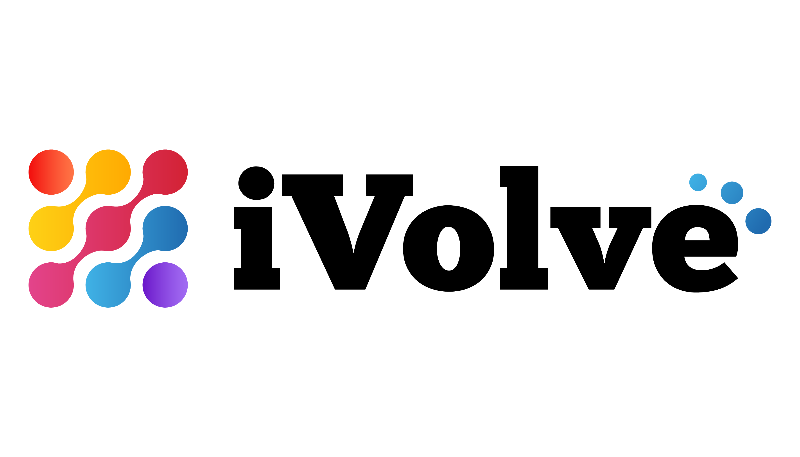

<p align="center">
  
  &nbsp;&nbsp;&nbsp;&nbsp;&nbsp;&nbsp;&nbsp;&nbsp;
  
</p>

# 🎓 NTI & iVolve DevOps Graduation Final Project
### End-to-End Cloud DevOps Lifecycle Implementation

[](https://github.com/Moha-sys/graduation_project_ivolve)
[](https://www.terraform.io/)
[-FF9900?logo=amazon-aws)](https://github.com/floci-cloud/floci)
[](https://www.ansible.com/)
[](https://kubernetes.io/)
[](https://www.jenkins.io/)
[](https://argoproj.github.io/cd/)

---

## 📋 Table of Contents
1. [Project Overview & Objectives](#-project-overview--objectives)
2. [High-Level Architecture](#-high-level-architecture)
3. [Repository Layout](#-repository-layout)
4. [Step 1: Containerization with Docker](#1-containerization-with-docker)
5. [Step 2: Infrastructure as Code with Terraform & Floci](#2-infrastructure-as-code-with-terraform--floci)
6. [Step 3: Configuration Management with Ansible](#3-configuration-management-with-ansible)
7. [Step 4: Container Orchestration with Kubernetes](#4-container-orchestration-with-kubernetes)
8. [Step 5: Continuous Integration with Jenkins & Shared Library](#5-continuous-integration-with-jenkins--shared-library)
9. [Step 6: Continuous Deployment with Argo CD (GitOps)](#6-continuous-deployment-with-argo-cd-gitops)
10. [End-to-End Verification & Validation](#-end-to-end-verification--validation)

---

## 🌟 Project Overview & Objectives

This project represents the final graduation milestone for the **National Telecommunication Institute (NTI)** DevOps Training Track in partnership with **iVolve Technologies**.

The core objective is to design, provision, configure, and automate a complete, enterprise-grade cloud DevOps ecosystem that hosts a multi-tier microservices application through:
* **Docker & Docker Compose:** Containerizing microservices and local multi-tier integration.
* **Terraform & Floci:** Provisioning cloud network, compute, container registry, and managed Kubernetes infrastructure with S3 remote state backend, using **Floci** as a fast local AWS emulator.
* **Ansible:** Configuring the Jenkins CI runner using modular roles and dynamic EC2 inventory.
* **Kubernetes (EKS):** Zero-downtime microservices orchestration with StatefulSets, Headless Services, StorageClasses, ConfigMaps, Secrets, Probes, and Ingress routing.
* **Jenkins CI & Shared Library:** Automating a 6-stage CI pipeline with custom shared libraries, Trivy vulnerability scanning, container registry publishing, and automated GitOps manifest patching.
* **Argo CD:** Enforcing automated GitOps continuous deployment with automated reconciliation and self-healing.

---

## 🏛️ High-Level Architecture

### Microservices & Infrastructure Overview

```text
                                        ┌─────────────────────────────────┐
                                        │          User Browser           │
                                        └────────────────┬────────────────┘
                                                         │ HTTP (Port 80 / Ingress)
                                                         ▼
                                 ┌──────────────────────────────────────────────┐
                                 │            Kubernetes Ingress                │
                                 └───────────────────────┬──────────────────────┘
                                                         │
                                                         ▼
                                      ┌────────────────────────────────────┐
                                      │       Frontend Microservice        │
                                      │       Node.js / Express / EJS      │
                                      │       Port: 3000 (2 Replicas)      │
                                      └─────────────┬────────────────┬─────┘
                                                    │                │
                        ┌───────────────────────────┘                └──────────────────────────┐
                        │ HTTP POST                                                             │ HTTP GET
                        ▼                                                                       ▼
    ┌──────────────────────────────────────┐                               ┌──────────────────────────────────────┐
    │       Auth Microservice              │                               │      Roadmap Microservice            │
    │       Python / Flask                 │                               │      Java / Spring Boot 3            │
    │       Port: 5000 (2 Replicas)        │                               │      Port: 8080 (2 Replicas)         │
    └───────────────────┬──────────────────┘                               └──────────────────────────────────────┘
                        │ TCP (Port 3306)
                        ▼
    ┌──────────────────────────────────────┐
    │       MySQL Database                 │
    │       StatefulSet + Headless Svc     │
    │       StorageClass (5Gi Volume)      │
    └──────────────────────────────────────┘
```

### Complete GitOps CI/CD Lifecycle

```text
+----------------+      +-------------------+      +----------------------+
| Developer Push | ---> | Jenkins Pipeline  | ---> | Trivy Security Scan  |
+----------------+      +---------+---------+      +----------+-----------+
                                  │                           │
                                  ▼                           ▼
                        +-------------------+      +----------------------+
                        | Push Image to ECR | ---> | Update Git Manifests |
                        +-------------------+      +----------+-----------+
                                                              │
                                                              ▼
+----------------+      +-------------------+      +----------------------+
| Kubernetes EKS | <--- |  Argo CD GitOps   | <--- | Push Commit to Repo  |
| (ivolve ns)    |      |  Auto Sync        |      | (main branch)        |
+----------------+      +-------------------+      +----------------------+
```

---

## 📁 Repository Layout

```text
graduation_project_ivolve/
├── README.md                           # Main comprehensive project documentation
├── docker-compose.yml                  # Root Compose stack (Frontend, Auth, Roadmap, MySQL, Floci)
├── .gitignore                          # Git ignore definitions
├── ProjectTasks.pdf                    # Official project specification PDF
│
├── database/
│   └── init.sql                        # MySQL schema initialization script
│
├── frontend/                           # Frontend microservice (Node.js, Express, EJS)
│   ├── Dockerfile                      # Production Docker container image definition
│   ├── package.json
│   ├── server.js
│   ├── Jenkinsfile                     # Microservice CI pipeline definition
│   ├── public/                         # Static assets (CSS, logos)
│   └── views/                          # EJS templates (auth, roadmap, error)
│
├── auth-service/                       # Authentication microservice (Python Flask)
│   ├── Dockerfile
│   ├── requirements.txt
│   ├── app.py
│   └── Jenkinsfile
│
├── roadmap-service/                    # Roadmap microservice (Java Spring Boot 3)
│   ├── Dockerfile                      # Multi-stage Maven build & JRE runtime
│   ├── pom.xml
│   ├── Jenkinsfile
│   └── src/
│
├── terraform/                          # Infrastructure as Code (AWS / Floci)
│   ├── provider.tf                     # AWS provider with Floci local endpoint routing
│   ├── backend.tf                      # S3 remote state backend configuration
│   ├── variables.tf                    # Configurable infrastructure variables
│   ├── main.tf                         # Root module orchestrating child modules
│   ├── outputs.tf                      # Infrastructure resource outputs
│   ├── terraform.tfvars.example        # Sample variable definitions
│   ├── README.md                       # Terraform & Floci execution guide
│   ├── floci/                          # Floci local cloud emulation tooling
│   │   ├── docker-compose.floci.yml    # Floci container definition (Port 4566)
│   │   ├── init-floci-s3.sh            # S3 bucket initializer for Terraform backend
│   │   └── README.md
│   └── modules/
│       ├── network/                    # VPC, 2 public & 2 private subnets, IGW, NAT, NACLs
│       ├── server/                     # Jenkins EC2 instance + Security Groups
│       ├── eks/                        # EKS Cluster + Managed Node Group (2 workers)
│       └── ecr/                        # ECR repositories for all 3 microservices
│
├── ansible/                            # Configuration Management for Jenkins Server
│   ├── ansible.cfg                     # Ansible runtime configuration
│   ├── playbook.yml                    # Master configuration playbook
│   ├── README.md                       # Ansible usage & role documentation
│   ├── inventory/
│   │   ├── aws_ec2.yml                 # AWS EC2 dynamic inventory plugin
│   │   ├── floci_inventory.py          # Dynamic inventory script for Floci & local
│   │   └── hosts.ini                   # Static inventory fallback
│   └── roles/
│       ├── common/                     # Base utilities (curl, git, jq, certificates)
│       ├── java/                       # OpenJDK 17 LTS installation & JAVA_HOME
│       ├── jenkins/                    # Jenkins LTS repository, service & readiness
│       ├── docker/                     # Docker CE runtime & user group permissions
│       └── trivy/                      # Aqua Security Trivy scanner installation
│
├── k8s/                                # Kubernetes manifests for EKS Cluster
│   ├── README.md                       # Kubernetes deployment documentation
│   ├── namespace.yaml                  # ivolve namespace
│   ├── storageclass.yaml               # StorageClass definition for volume dynamic binding
│   ├── configmap.yaml                  # Environment configuration
│   ├── secret.yaml                     # Database credentials & JWT session secrets
│   ├── ingress.yaml                    # Ingress controller resource for frontend
│   ├── database/
│   │   ├── mysql-statefulset.yaml      # StatefulSet with volumeClaimTemplates (5Gi)
│   │   └── mysql-service.yaml          # Headless service (clusterIP: None)
│   ├── auth-service/
│   │   ├── deployment.yaml             # 2 replicas, wait-for-mysql initContainer, probes
│   │   └── service.yaml                # ClusterIP service (Port 5000)
│   ├── roadmap-service/
│   │   ├── deployment.yaml             # 2 replicas, health probes
│   │   └── service.yaml                # ClusterIP service (Port 8080)
│   └── frontend/
│       ├── deployment.yaml             # 2 replicas, health probes
│       └── service.yaml                # ClusterIP service (Port 3000)
│
├── vars/                               # Jenkins Shared Library Directory
│   ├── buildImage.groovy               # Build, Scan with Trivy, Push to Registry, Delete locally
│   ├── updateManifests.groovy          # GitOps: update k8s manifest image tag and git push
│   └── runTests.groovy                 # Automated test runner step
│
├── pipelines/                          # Microservices CI Pipeline Declarations
│   ├── Jenkinsfile-frontend
│   ├── Jenkinsfile-auth-service
│   └── Jenkinsfile-roadmap-service
│
└── argocd/                             # GitOps Continuous Deployment Configuration
    ├── application.yaml                # Argo CD Application Custom Resource (auto-sync)
    ├── setup-argocd.sh                 # Cluster installation and registration script
    └── README.md
```

---

## 1. Containerization with Docker

The application stack consists of three microservices and a MySQL database. All services are containerized using standard Dockerfiles and orchestrated locally using `docker-compose.yml`.

### Port & Communication Matrix

| Service | Technology | Port | Dependencies |
| :--- | :--- | :--- | :--- |
| **Frontend** | Node.js / Express | `3000` | Auth Service, Roadmap Service |
| **Auth Service** | Python / Flask | `5000` | MySQL Database |
| **Roadmap Service** | Java / Spring Boot 3 | `8080` | None |
| **MySQL** | Relational Database | `3306` | None |
| **Floci** | Local AWS Cloud Emulator | `4566` | None |

### Running the Complete Stack Locally

```bash
# Clone the repository
git clone https://github.com/Moha-sys/graduation_project_ivolve.git
cd graduation_project_ivolve

# Build and start all containers
docker compose up -d --build

# Verify container statuses and health probes
docker compose ps
```

Visit `http://localhost:3000` to interact with the application.

---

## 2. Infrastructure as Code with Terraform & Floci

Terraform is used to define and provision the complete cloud infrastructure. As requested, **Floci** is used as a drop-in local AWS emulator listening on port `4566`, enabling offline testing without cloud costs.

### Provisioned Resources

1. **Network Module (`modules/network`)**:
   * VPC (`10.0.0.0/16`) with DNS support and hostnames enabled.
   * 2 Public Subnets (`10.0.1.0/24`, `10.0.2.0/24`) across AZs `us-east-1a` and `us-east-1b`.
   * 2 Private Subnets (`10.0.11.0/24`, `10.0.12.0/24`) across AZs `us-east-1a` and `us-east-1b`.
   * Internet Gateway (IGW) attached to the VPC.
   * Elastic IP (EIP) and NAT Gateway in public subnet for outbound private traffic.
   * Public Route Table (IGW) and Private Route Table (NAT Gateway).
   * Public and Private Network ACLs (NACL) with granular ingress/egress rules.
2. **Server Module (`modules/server`)**:
   * Jenkins EC2 instance (`t3.medium`).
   * Security Group permitting TCP port 22 (SSH), port 8080 (Jenkins UI), and port 50000 (JNLP Agents).
   * IAM Role and Instance Profile with ECR and EKS permissions.
3. **EKS Module (`modules/eks`)**:
   * Managed EKS Cluster provisioned inside private subnets.
   * Managed Node Group with 2 worker nodes distributed across different private subnets and AZs.
   * IAM Roles for Cluster and Node Groups with policies (`AmazonEKSClusterPolicy`, `AmazonEKSWorkerNodePolicy`, `AmazonEKS_CNI_Policy`, `AmazonEC2ContainerRegistryReadOnly`).
4. **ECR Module (`modules/ecr`)**:
   * Repositories for `ivolve-frontend`, `ivolve-auth-service`, and `ivolve-roadmap-service`.
   * Scan on push enabled and lifecycle policies retaining the last 10 images.
5. **Remote Backend**:
   * S3 remote state backend configured in `backend.tf` pointed to Floci S3.

### Executing Terraform with Floci

```bash
# 1. Start Floci Cloud Emulator
docker compose -f terraform/floci/docker-compose.floci.yml up -d

# 2. Initialize S3 Backend State Bucket in Floci
./terraform/floci/init-floci-s3.sh

# 3. Initialize & Deploy Terraform
cd terraform
terraform init
terraform plan
terraform apply -auto-approve
```

---

## 3. Configuration Management with Ansible

Ansible automates the post-provisioning configuration of the Jenkins EC2 instance.

### Ansible Roles Architecture

* **`roles/common`**: Updates system packages and installs base utilities (`curl`, `git`, `jq`, `unzip`, `ca-certificates`).
* **`roles/java`**: Installs OpenJDK 17 LTS and configures system-wide `JAVA_HOME`.
* **`roles/jenkins`**: Adds official Jenkins Debian repository, installs Jenkins LTS, starts the systemd service, and awaits port 8080 readiness.
* **`roles/docker`**: Installs Docker CE, containerd, enables service, and appends the `jenkins` user to the `docker` group.
* **`roles/trivy`**: Installs Aqua Security's Trivy vulnerability scanner.

### Dynamic Inventory & Execution

* **`inventory/aws_ec2.yml`**: AWS EC2 plugin querying instances tagged `Role: jenkins` and `Project: ivolve`.
* **`inventory/floci_inventory.py`**: Custom script returning instances from the local Floci emulator.

```bash
cd ansible
chmod +x inventory/floci_inventory.py

# Execute playbook using dynamic inventory
ansible-playbook -i inventory/aws_ec2.yml playbook.yml

# Or using static inventory
ansible-playbook -i inventory/hosts.ini playbook.yml
```

---

## 4. Container Orchestration with Kubernetes

All application components are deployed to the `ivolve` namespace on the EKS cluster.

### Orchestration Highlights

* **Stateful Database:** MySQL 8.0 is deployed as a **StatefulSet** backed by `ivolve-storage-class` with a 5Gi persistent volume claim. It is exposed via a **Headless Service** (`clusterIP: None`), granting the database a deterministic network identity (`mysql-service.ivolve.svc.cluster.local`).
* **Robust Startup:** The `auth-service` deployment features a `wait-for-mysql` **initContainer** (`busybox:1.36`) that probes TCP 3306 until the database accepts traffic before starting the main container.
* **Configuration Decoupling:** Credentials (`DB_USER`, `DB_PASSWORD`, `MYSQL_ROOT_PASSWORD`, `SESSION_SECRET`) are stored in Kubernetes **Secrets**, while non-sensitive connection endpoints are managed through **ConfigMaps**.
* **High Availability & Probes:** Each microservice runs 2 replicas with configured **Liveness** and **Readiness** HTTP probes, and CPU/memory resource requests and limits.
* **External Ingress:** An Ingress resource routes incoming HTTP traffic from `/` to `frontend-service:3000`.

### Applying Manifests

```bash
kubectl apply -f k8s/namespace.yaml
kubectl apply -f k8s/storageclass.yaml
kubectl apply -f k8s/configmap.yaml
kubectl apply -f k8s/secret.yaml
kubectl apply -f k8s/database/
kubectl apply -f k8s/auth-service/
kubectl apply -f k8s/roadmap-service/
kubectl apply -f k8s/frontend/
kubectl apply -f k8s/ingress.yaml
```

---

## 5. Continuous Integration with Jenkins & Shared Library

Each microservice is backed by a declarative Jenkins pipeline configured to use the custom **Jenkins Shared Library** (`vars/`).

### Required 6 Pipeline Stages

1. **Build Image:** Compiles and builds the Docker image tagged with `${BUILD_NUMBER}` and `latest`.
2. **Scan Image:** Runs Trivy vulnerability scans filtering on `HIGH` and `CRITICAL` severity CVEs.
3. **Push Image:** Authenticates against the container registry (DockerHub / ECR) and publishes both tags.
4. **Delete Image Locally:** Removes the built image from runner disk storage to preserve host storage.
5. **Update Manifests:** Dynamically updates the image tag in `k8s/<service>/deployment.yaml` using regex matching.
6. **Push Manifests:** Commits the updated manifest and pushes to the GitHub repository on the `main` branch.

### Shared Library Steps (`vars/`)

* **`buildImage.groovy`**: Encapsulates stages 1 through 4 (Build, Trivy Scan, Registry Push, Local Cleanup).
* **`updateManifests.groovy`**: Encapsulates stages 5 and 6 (Manifest regex update, git commit, git push).
* **`runTests.groovy`**: Automates unit tests (`mvn test`, `npm test`, `unittest`).

---

## 6. Continuous Deployment with Argo CD (GitOps)

Argo CD manages the cluster state using GitOps principles.

### Argo CD Configuration (`argocd/application.yaml`)

```yaml
apiVersion: argoproj.io/v1alpha1
kind: Application
metadata:
  name: ivolve-graduation-project
  namespace: argocd
spec:
  project: default
  source:
    repoURL: 'https://github.com/Moha-sys/graduation_project_ivolve.git'
    targetRevision: main
    path: k8s
    directory:
      recurse: true
  destination:
    server: 'https://kubernetes.default.svc'
    namespace: ivolve
  syncPolicy:
    automated:
      prune: true
      selfHeal: true
    syncOptions:
      - CreateNamespace=true
```

### Deploying Argo CD

```bash
chmod +x argocd/setup-argocd.sh
./argocd/setup-argocd.sh
```

---

## ✅ End-to-End Verification & Validation

| Verification Check | Command | Expected Result |
| :--- | :--- | :--- |
| **Docker Compose Services** | `docker compose ps` | All containers in `running (healthy)` state |
| **Floci AWS Emulator** | `curl -s http://localhost:4566` | Returns status 200 / Floci response |
| **Terraform Modules** | `terraform validate` | Success: `Success! The configuration is valid.` |
| **Ansible Lint & Syntax** | `ansible-playbook --syntax-check playbook.yml` | Syntax OK |
| **Kubernetes Pods** | `kubectl get pods -n ivolve` | All pods `Running` (2 frontend, 2 auth, 2 roadmap, 1 mysql) |
| **Kubernetes StatefulSet** | `kubectl get statefulset -n ivolve` | `mysql-db` 1/1 ready |
| **Kubernetes Ingress** | `kubectl get ingress -n ivolve` | `ivolve-ingress` bound to host/IP |
| **Argo CD Sync Status** | `kubectl get app -n argocd` | `ivolve-graduation-project` Synced & Healthy |

---

## 👤 Author & Acknowledgments

* **Student:** Mohamed Ashraf Kharoub ([@Moha-sys](https://github.com/Moha-sys))
* **Organization:** National Telecommunication Institute (NTI)
* **Partner:** iVolve Technologies
* **Program:** Final DevOps Graduation Project
* **Repository:** [https://github.com/Moha-sys/graduation_project_ivolve](https://github.com/Moha-sys/graduation_project_ivolve)
